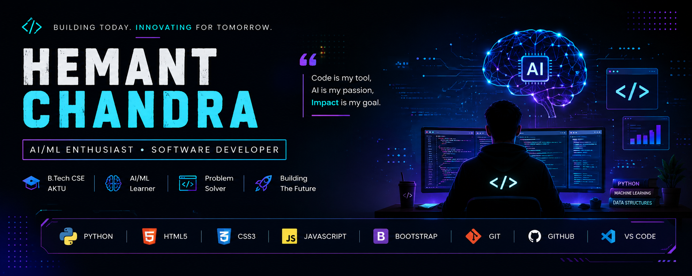

  

<h2 align="center">AI/ML Enthusiast | Software Developer</h2>

Building today. Innovating for tomorrow. 🚀

---

## 👨‍💻 About Me

- 🎓 Final-year B.Tech Computer Science student at AKTU
- 🤖 Exploring Artificial Intelligence, Machine Learning & Data Science
- 💻 Building web development projects and strengthening programming fundamentals
- 🎯 Aspiring AI/ML Engineer passionate about solving real-world problems

## 🛠️ Tech Stack

  

## 🚀 Featured Projects

### 🛒 The Jarvis Cart
An e-commerce website project.

[View Repository](https://github.com/hemant-chandra/The_Jarvis_Cart)

### 🐾 Pet Adoption Page
A frontend website designed for pet adoption.

[View Repository](https://github.com/hemant-chandra/pet_adoption_page)

### ✅ Todo App
A task management project for practising frontend development.

[View Repository](https://github.com/hemant-chandra/Todo-app)

## 🤝 Connect With Me

- 💼 [LinkedIn](https://www.linkedin.com/in/hemant-chand/)
- 🐙 [GitHub](https://github.com/hemant-chandra)

---

✨ Building today. Innovating for tomorrow. ✨

## 📊 GitHub Analytics\n\n
\n  \n  \n

